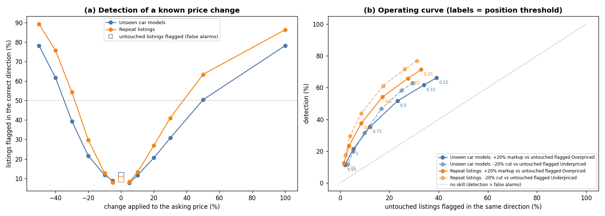
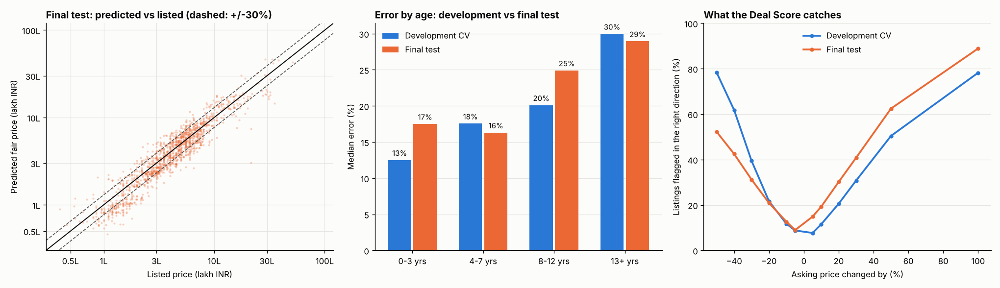
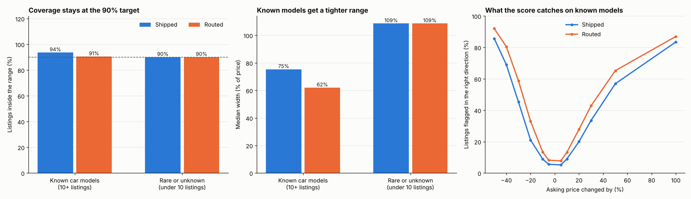
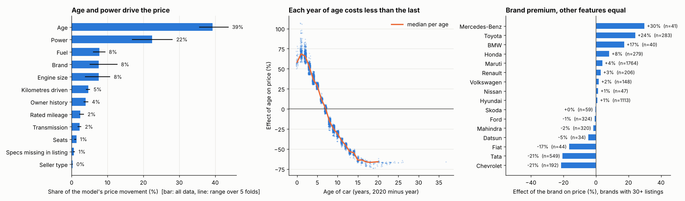
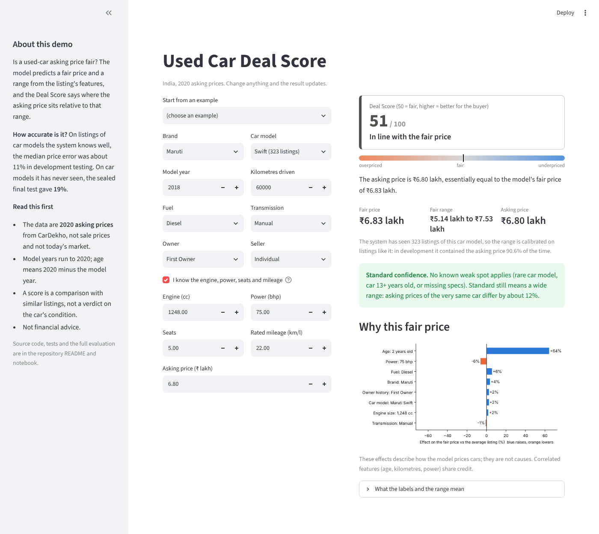

# Used Car Deal Score (India)

Is this used-car listing fairly priced? This project predicts a fair price for Indian used-car listings **together with an honest uncertainty range**, then turns the gap between the asking price and that range into a 0-100 *Deal Score*.

**Status: complete.** Data audit, cleaning, EDA, grouped validation, model selection, conformal ranges, error analysis, SHAP explanations, Deal Score validation, familiarity routing, a pre-registered one-shot final test, and a demo app. The tables below are development cross-validation unless they say "final test".

## At a glance
- **Fair-price accuracy:** median error about 11% for car models the system knows (10+ listings), 19% on a sealed test of 42 car models it had never seen (best simple baseline: 34%).
- **Honest range:** the 90% range contained the asking price 90.6% of the time for known models in development, and 84.1% on the final test of unseen models. That test missed its pre-registered 85% floor, and the result is reported as a failure, not repaired.
- **Deal Score (0-100):** the asking price's position inside that range. It reliably catches large gaps only (a 20% markup is detected 21-30% of the time), so it is a screening aid, not a verdict.
- **Rigour:** duplicates removed before splitting, validation by whole car model, rules committed to git before results, every decision in the [decision log](docs/decision_log.md) (D1-D52).

## Data
- Source: Kaggle "Vehicle dataset" by Nehal Birla (CarDekho), file `Car details v3.csv`, 8,128 rows. The file is not committed: download it into `data/raw/`.
- Licence: to be confirmed from the Kaggle page, see [`data/README.md`](data/README.md).
- Limits: prices are asking prices, not transaction prices; there is no city column; the data ends in 2020, so 2020 is treated as "now" and all prices are 2020-era INR.

## Approach
- **Cleaning:** 1,202 exact duplicate rows removed before any split; units parsed to numbers; physically impossible usage removed (4 rows); the 209 rows with missing specs kept, because they are older and cheaper, not random.
- **Target:** log(price), since depreciation works in percentages.
- **Validation:** 20% of the *car models* are locked away as the final test set. Development uses 5-fold cross-validation grouped by car model, so the model is judged on cars it has never seen. Every model is also scored on a random split ("typical repeat listing"). All preprocessing sits inside the pipeline.
- **Why the validation matters:** the same random forest scores R² 0.934 with duplicates and a random split, 0.906 once de-duplicated, and 0.810 when whole car models are held out.
- **Intervals:** conformalized quantile regression (nominal 90%), calibrated on held-out car models, with a locally adaptive variant selected by a rule fixed before looking at the results.
- Every decision, including the ones that did not pay off, is in [`docs/decision_log.md`](docs/decision_log.md).

## Results (development cross-validation, 5,530 listings)

| Model | Unseen car models: RMSE (log price) | Unseen car models: median error | Repeat listings: median error |
|---|---|---|---|
| Baseline: linear on age + log km | 0.528 | 28.7% | not measured |
| Ridge | 0.280 | 16.8% | 15.0% |
| **LightGBM (selected)** | 0.294 | 17.6% | 11.9% |

Ridge and the boosted models are statistically indistinguishable on unseen car models (fold standard deviation 0.02-0.04); boosting is clearly better on repeat listings. Repeat-listing figures keep near-duplicate relistings of the same car inside one fold (notebook Section 8); doing so changed no result by more than 0.22 points.

| 90% interval (adaptive CQR) | Coverage | Median width (% of price) |
|---|---|---|
| Unseen car models | 88.2% | 86% |
| Repeat listings | 90.5% | 65% |

Known weakness, disclosed rather than fixed: coverage on diesel listings is 85.6% against 91.3% for petrol on unseen models, and none of the three methods tried closed the gap.

## Does the Deal Score work? (notebook Section 12)

There are no labelled bargains, so the Deal Score was tested by changing the asking price of held-out listings by a known amount and counting how often it notices, using out-of-fold predictions only. The rules were fixed before the results were seen.

| Deal Score check (development, out-of-fold) | Unseen car models | Repeat listings |
|---|---|---|
| Untouched listings flagged either way (false-alarm upper bound) | 11.8% | 9.5% |
| Detected after a -30% price change | 39% | 54% |
| Detected after a -20% price change | 22% | 30% |
| Detected after a -10% price change | 12% | 13% |
| Detected after a +10% price change | 12% | 13% |
| Detected after a +20% price change | 21% | 27% |
| Detected after a +30% price change | 31% | 41% |
| Median price error, low-confidence vs other listings | 27.6% vs 16.8% | 20.2% vs 10.8% |



- **It detects large gaps, not small ones.** A 10% change is barely distinguishable from untouched listings; roughly half of a 50% markup is caught on unseen car models. Read "Overpriced" as "clearly outside what similar listings ask".
- **The false-alarm figure is an upper bound,** because some untouched listings may really be mispriced.
- **A low-confidence notice** (car model rare or unknown in the data, car 13+ years old, specs missing) marks listings where the price error is about 1.7-1.9 times larger. It does not lower the false-alarm rate in every regime, so it is shown as a warning next to the label rather than replacing it.
- The range was too wide for well-known car models (the open point of this section, D45); Section 13 below fixes it by routing on familiarity.

## Final test (notebook Section 14, locked test set, run once)



The criteria were committed to git before the test was run (commit `c86f112`). The test holds 1,392 listings of 42 car models the system has never seen, so it measures the stress-test regime only; it cannot test the known-model route of Section 13.

| | Development CV (unseen models) | Final test |
|---|---|---|
| Median price error | 17.6% | **19.1%** (best baseline: 34.2%) |
| R² on log price | 0.851 | 0.847 |
| 90% range coverage | 88.2% | **84.1%** (interval over car models: 77.0% to 89.4%) |
| Median range width, % of price | 85.7% | 80.6% |
| Untouched listings flagged either way | 11.8% | 15.9% |

**Result: the primary criterion failed.** Accuracy criteria (T1) all passed and the range width (T2b) passed, but range coverage (T2a) was 84.1% against a pre-set floor of 85%. Two secondary criteria also failed (T3a detection of a 20% markup 30% vs 21% in development; T3c untouched flags 15.9% vs a 15% cap). One was not evaluable (only 21 test listings with missing specs). Nothing was re-fitted or relaxed afterwards.

- **Why (post-hoc, after seeing the result):** coverage is 75% for 0-3 year-old cars (89% in development) and low for a few whole car models (Maruti Alto 800 61%, Tata Zest 67%, Honda Amaze 74%), the same "whole models mispriced" pattern as Section 9. With only 42 car models the coverage estimate is noisy (77% to 89%), and development folds ranged from 82% to 94%, so 84% is not out of line; the pre-set floor was tighter than that noise allowed.
- **What to take from it:** for a car model the system has never seen, expect the "90% range" to contain the asking price about 84% to 88% of the time, and treat the Deal Score on very new cars as weaker.

## Where the model is wrong (notebook Section 9)
- Most large errors are whole car models that the price model mis-prices as a group when it has not seen them: budget models such as the Tata Nano (+130% median over-prediction), Mahindra Xylo (+78%) and Tata Indica (+42%), and the reverse for a model with strong resale such as the Toyota Innova (-40%).
- Error rises with age: 12.5% typical error up to 3 years old, 29.9% beyond 12 years. Listings with missing specs are worse (25.5% vs 17.3%).
- There is no systematic bias by predicted price. The costly failure for a Deal Score is a *false bargain*: on unseen models the fair price is at least 30% above the listing for 14.3% of listings (9.2% on repeat listings).
- Adding the car model's identity as a feature (Section 10, tested against a rule fixed in advance) lowers the repeat-listing error from 11.9% to 11.4% and cannot help models the system has not seen. It is used for known car models only (Section 13).

## Routing by familiarity (notebook Section 13)



The system now treats a car model it has seen 10 or more times differently from one it has not:

| Repeat-listing folds, development | Shipped before | Routed |
|---|---|---|
| Median price error, all listings | 11.90% | 11.35% |
| Range coverage (target 90%) on known car models | 93.7% | 90.6% |
| Median range width on known car models, % of price | 75% | 62% |
| Range coverage on rare or unknown car models (unchanged, held-out-model calibration) | 90.1% | 90.1% |
| Detection of a +20% markup / -20% cut on known car models | 20.0% / 21.0% | 27.8% / 33.0% |
| Untouched known-model listings flagged either way | 6.3% | 9.4% |

- Known car models get the identity point model (Section 10) and a range calibrated on random listings; everything else keeps the range calibrated on held-out car models, because calibrating those on random listings would under-cover them (84.6%).
- The rules were fixed before the results were seen; all passed. The coverage of the unfamiliar branch is close to target but its interval (86.9% to 92.7%) is wide because only 416 listings fall in that branch.
- `deal_score(..., model_key=...)` and `explain_listing(..., model_key=...)` follow the same route, so the fair price, the range, the drivers and the confidence notes always refer to the same model.

## What drives the price (notebook Section 11)



- Age (39% of the model's price movement) and power (22%) dominate; fuel, brand and engine size follow with about 8% each. The ranking is the same on all five held-out folds of car models and agrees with permutation importance (rank correlation 0.94).
- Each listing gets a breakdown such as "age +30%, power +10%, diesel +6%", and the factors multiply exactly to the fair price (`src/explain.py`). The Deal Score then says how far the asking price sits from that fair price.
- These are descriptions of the model on 2020 asking prices, not causal claims. Rated mileage and seats add no usable signal on unseen car models.

## Demo app (Step 14)


A Streamlit app wraps `deal_score` and `explain_listing`: pick a car model (its typical specs pre-fill), enter year, kilometres and asking price, and it shows the 0-100 score, the fair price and range, a confidence badge, and the price drivers. It validates inputs, warns on out-of-range values, and states its limits in the sidebar (2020 asking prices; range holds about 90% for known car models and about 84-88% for unfamiliar ones; the median error is about 11% on known models and 19% on unseen ones in the final test). The app trains nothing; it reads the saved artifacts and `app/model_catalog.json`, both written by the notebook.
```bash
streamlit run app/streamlit_app.py     # from the repo root, after the notebook has run
python -m pytest tests -q              # 19 tests, about 2 minutes (skipped if the notebook has not run)
```

## Repository layout
```
notebooks/Used_Cars_Cost_Prediction.ipynb   the full analysis, top to bottom
src/conformal.py                            interval classes (CQR variants)
src/deal_score.py                           deal_score(features, listed_price, model_key=...): fair price, range, label, confidence notice, route
src/deal_validation.py                      price-injection test and confidence-flag tools (notebook Section 12)
src/explain.py                              explain_listing(features): why the fair price is what it is (SHAP)
src/demo.py                                 input checks and assess(): the logic behind the app
app/streamlit_app.py                        the demo app; app/model_catalog.json is written by notebook Section 15
tests/test_demo.py                          tests for the demo logic and the app
docs/decision_log.md                        every modelling decision, numbered
data/README.md                              data source, licence, caveats
models/                                     generated, git-ignored
reports/figures/                            figures saved by the notebook
```

## How to run
```bash
python -m venv .venv
source .venv/bin/activate          # Windows: .venv\Scripts\activate
pip install -r requirements.txt    # pinned to the versions this was verified with
# download "Car details v3.csv" into data/raw/
cd notebooks
jupyter nbconvert --to notebook --execute --inplace Used_Cars_Cost_Prediction.ipynb   # about 5-10 minutes, depending on your CPU
jupyter nbconvert --to html Used_Cars_Cost_Prediction.ipynb
```
Running the notebook also **regenerates the five files in `models/`**, which are not committed (pickled models only load under compatible library versions). Old `.joblib` files from before `src/conformal.py` existed will not load; delete them and re-run.

Try the Deal Score once the notebook has run (from the repo root):
```python
import math
from src.deal_score import deal_score

car = {"age": 6, "log_km": math.log1p(70000), "log_engine": math.log(1248), "log_power": math.log(81.8),
       "seats": 5, "mileage_val": 19.5, "fuel": "Diesel", "transmission": "Manual",
       "owner": "First Owner", "seller_type": "Individual", "brand": "Maruti"}
deal_score(car, 450000, model_key="Maruti Swift")   # fair price, 90% range, gap %, 0-100 score, label, confidence, route
```

## Version 2 (not done, and why)
- **Age-conditional calibration.** The final test showed the range is too narrow for 0-3 year-old cars (75% coverage) and too wide for 13+ year-old cars (98%). Calibrating the range per age band is the obvious fix; it was not applied because the test set is spent, so it would need fresh data to validate.
- **Newer data and a city column.** The data end in 2020 and have no city. A current scrape would make the demo usable on today's market.
- **Sale prices instead of asking prices**, which would change what "fair" means.

## Limitations
- A Deal Score compares an asking price with what similar *listings* cost. It cannot see condition, accident history, city or negotiation, so it is not a verdict on the car.
- Two listings of the same car differ by a median of about 11.6%, which bounds how precise any fair-price estimate can be.
- 2020-era prices; no city.
